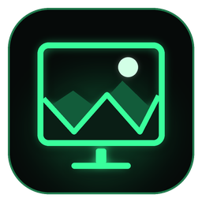
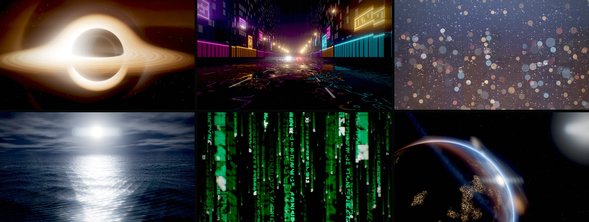

# WallForge for Windows

Hyper-realistic **live wallpapers** that play behind your desktop icons. Every scene is rendered in real time with cinematic lighting, reflections, depth of field, bloom and film grain, so nothing loops in an obvious way.

**[⬇ Download the latest installer](https://github.com/azaan-ship-it/WallForge-App/releases/latest)**

## 19 built-in wallpapers

* **Hacker**: Matrix code rain, hacker terminal, cyber grid server aisle, circuit board macro.
* **Weather**: rain on glass, thunderstorm city, snowy cabin window, crackling fireplace, sunlit reef.
* **Cars**: showroom car, neon night drive, garage reveal.
* **Space**: nebula flight, Earth from orbit, black hole, aurora lake, warp drive.
* **Cyberpunk**: neon alley, ocean at night.

Plus your own: import **MP4 / WebM videos, images, GIFs or HTML pages**. Videos loop seamlessly and start muted.

## Features

* Speed, intensity, colour tint, quality (Low / Medium / High / Ultra) and a 30 or 60 FPS cap for each wallpaper.
* A different wallpaper on each monitor.
* Playlist mode that changes the wallpaper every few minutes.
* Optional ambient sound (rain, fire, wind, ocean and more), off by default.
* Tray icon to pause, skip, open the library or quit, and an option to start with Windows.
* One click to save the current wallpaper as your **lock screen**.

## Light on your PC

* Pauses automatically while a fullscreen app or game is running, and when the desktop is covered.
* Lowers the frame rate (or pauses) on battery.
* Built to run smoothly on Medium on laptops with integrated graphics (tested on Intel Iris Xe). Settings shows live CPU and GPU usage.
* Close it and your normal Windows wallpaper comes straight back.

## Install

1. Download `WallForgeSetup.exe` from [Releases](https://github.com/azaan-ship-it/WallForge-App/releases/latest) and run it (no admin needed).
2. If Windows SmartScreen says it doesn't recognise the app, click **More info → Run anyway**.

Optional extras: drop a free car model, HDRI lighting or NASA Earth textures into the assets folder (Settings → *Open assets folder*) to make some scenes even more realistic. The README in that folder lists exactly what to download.

Windows 10/11, 64-bit. Made by ByteForge Studios.
